# Gitmo: a phone for SnowRunner

Gitmo adds a phone to SnowRunner. You can send money to the friends you play co-op with, text them (with photos and emoji) and listen to internet radio while you drive. It works on a flat screen and in VR (with the [Snowrunner-VR](https://github.com/Timguin-87/Snowrunner-VR) mod).

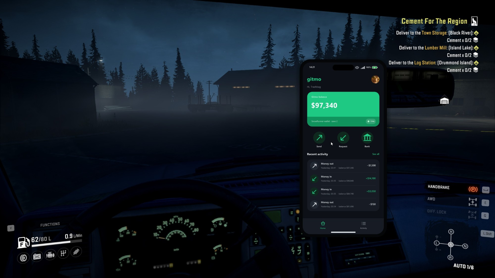

<p>
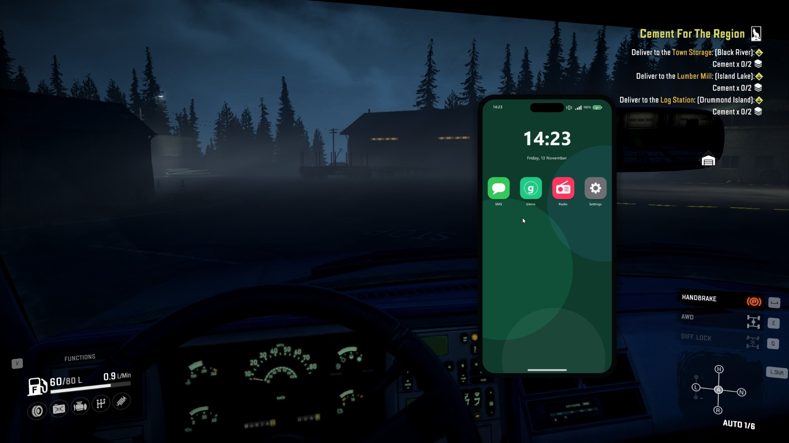
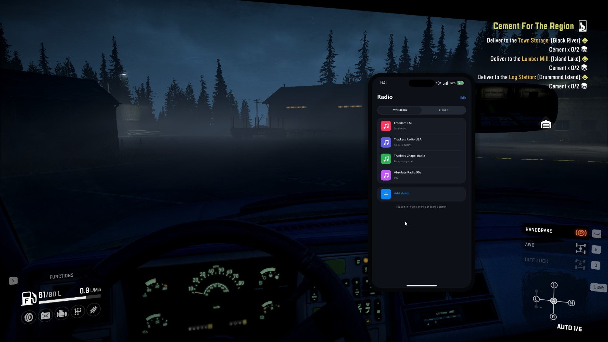
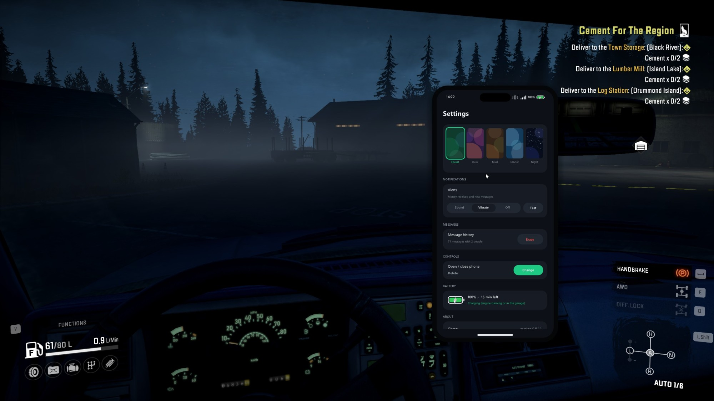
</p>

Press **Delete** in game to open or close the phone. You can change the key on the phone.

<p>
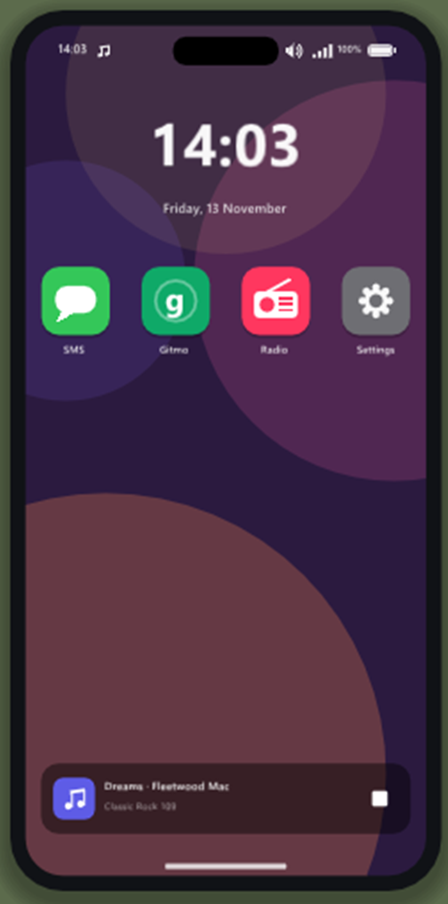
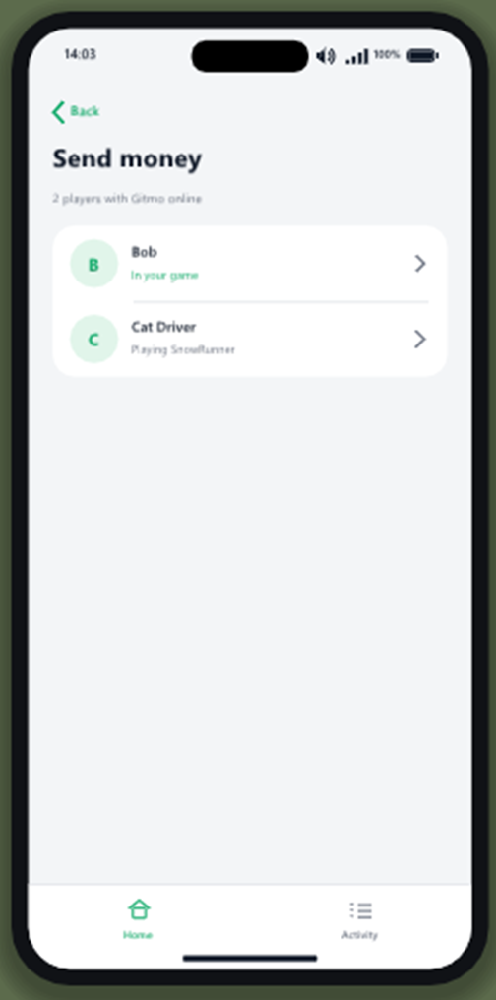
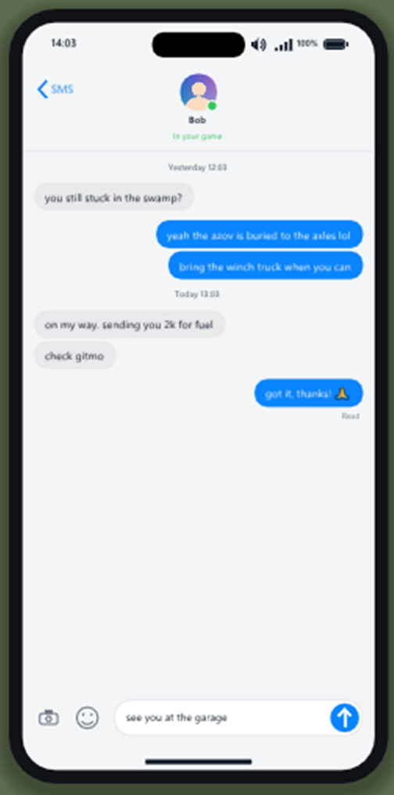
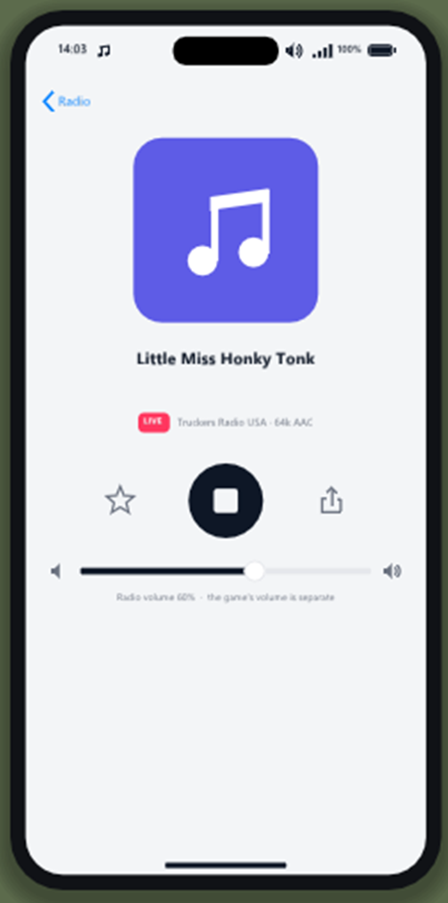
</p>

## Apps

- **Gitmo** shows your balance and activity, and lets you send money to another player in your co-op session. Every transfer has to be accepted by the person receiving it. Money only moves after they accept, and it moves exactly once. Sending is blocked while you're in a garage, because the garage screen holds on to your old balance.
- **SMS** lets you text other Gitmo players: emoji, photos (taken from the game view, without the phone, or picked from your screenshots) and shared radio stations you tap to play. Messages to someone offline are sent when they come back online.
- **Radio** plays internet radio, MP3 and AAC streams. It has its own station list and a browser for thousands of stations. It keeps playing with the phone put away and through map changes.
- **Settings** has dark mode, wallpapers, a cracked screen, notification sound/vibrate/off, the phone's size and position, and a battery that drains with the engine off.

<p>
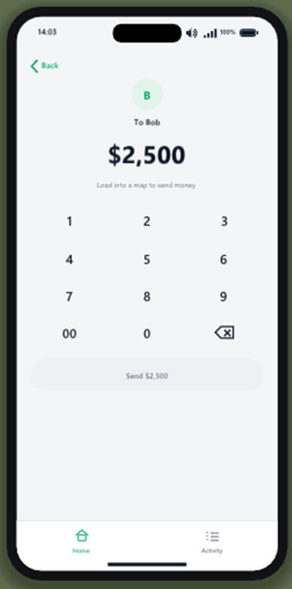
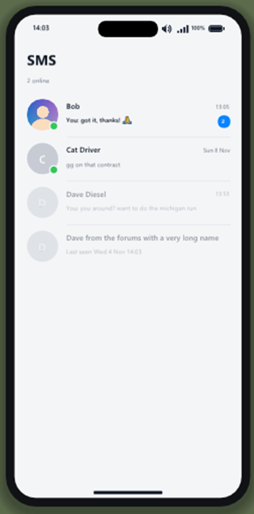
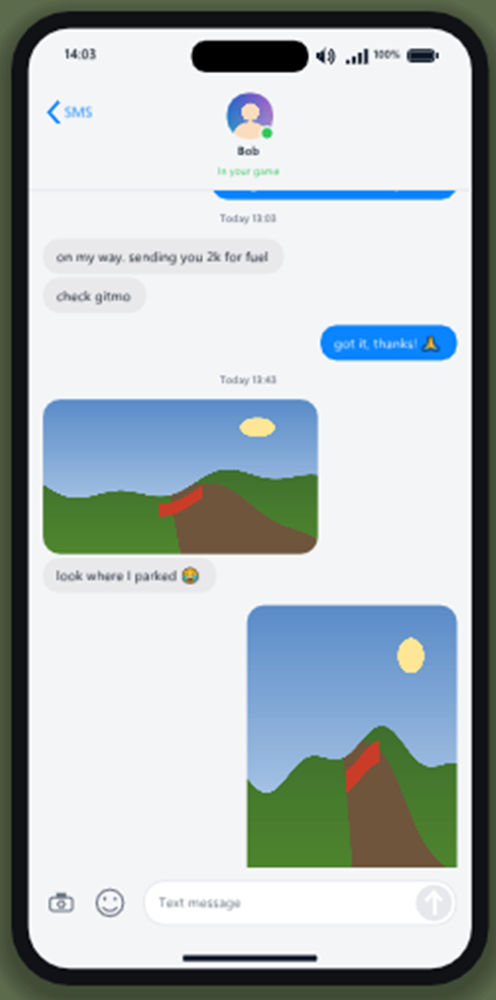
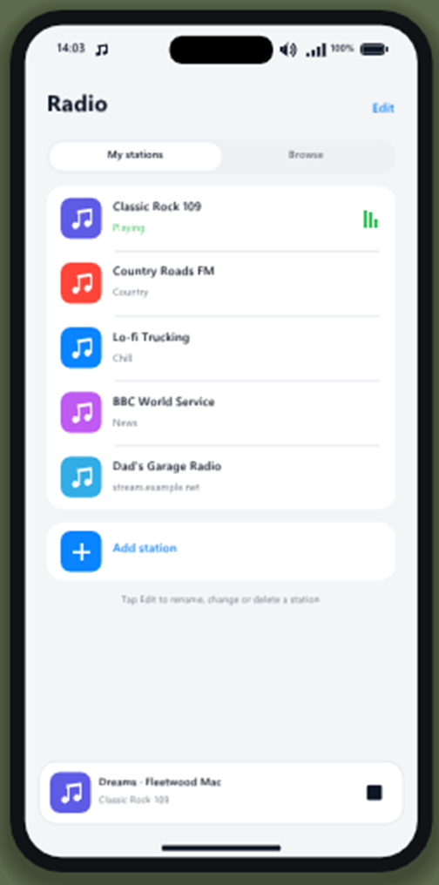
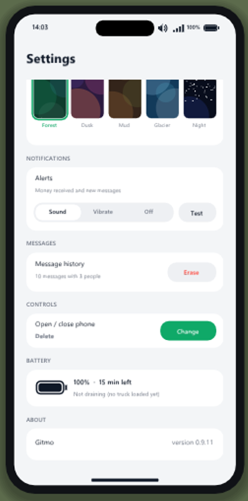
</p>

## Install

1. Download the latest `Gitmo-v*.zip` from [Releases](../../releases) and unzip it.
2. Close SnowRunner and double-click **Install Gitmo.bat**. It finds the game through Steam and copies `version.dll` and `Gitmo.ini` next to `SnowRunner.exe`.
3. Start the game and press **Delete**.

To remove it, double-click **Uninstall Gitmo.bat**. Gitmo doesn't change any game files, so deleting `version.dll` is enough.

[`dist/README.txt`](dist/README.txt) is the full player guide: every app, every setting and the version history.

**Requirements**
- The Steam version of SnowRunner on Windows 10/11 (x64).
- Transfers, SMS and the in-your-game check use Steam networking, so **both players need Gitmo**.
- Without Steam (Epic and other stores), only the phone's own features can work: balance, radio and camera. Gitmo hasn't been tested there.

## How it works

- `version.dll` is a proxy for the Windows DLL of the same name: the game loads it, and Gitmo forwards every real call to `System32\version.dll`. Nothing on disk is patched.
- The phone is drawn with Dear ImGui on the game's Direct3D 11 swap chain. In VR it's submitted as its own OpenXR quad layer through the VR mod's OpenXR session.
- Balance: Gitmo finds the game's live profile record in memory, checked against the save files, and follows whichever copy the game itself writes.
- Transfers and SMS: Steam `ISteamNetworkingMessages` on Gitmo's own channel, with a small protocol: offer, accept, pay and receipt, with ids that are only ever credited once.
- "In your game": SnowRunner's co-op runs through Saber's own session service, not Steam lobbies. Gitmo asks the game's session SDK for the current session's member list.
- Gitmo hooks only what it needs (DirectInput, `GetAsyncKeyState`/`GetKeyState`, XInput reads, `Present`) and leaves alone any hook another mod already holds. That way it chains with other mods instead of fighting them.

## Building

Needs Visual Studio 2022 Build Tools (MSVC, x64). Dear ImGui and the OpenXR headers are included under `third_party/`.

```bat
build.cmd        :: build\version.dll
build-test.cmd   :: build\test\version.dll, with the scripted UI test phases (GITMO_TEST_PHASE)
tests\build-tests.cmd   :: transfer and chat protocol tests (lossy, duplicated, reordered messages)
```

Source layout:

| Path | What |
|---|---|
| `src/gitmo.cpp` | DLL entry, settings (`Gitmo.ini`), logging |
| `src/overlay.cpp` | D3D11 hook, ImGui setup, input capture, photo capture |
| `src/ui.cpp`, `src/ui_radio.inc` | the phone and its apps |
| `src/money.cpp`, `src/game.cpp` | balance tracking, game state (engine, garage, session) |
| `src/transfer.cpp`, `src/chat.cpp` | transfer and SMS protocol engines (pure logic, unit-tested) |
| `src/net.cpp` | Steam glue, session detection, avatars, screenshots |
| `src/radio.cpp` | internet radio: HTTP streaming, ICY metadata, MP3/AAC decode |
| `src/vr.cpp` | the OpenXR phone panel |
| `src/photo.cpp`, `src/emoji.cpp` | JPEG encode/decode, colour emoji |
| `src/input.cpp`, `src/watchdog.cpp` | input blocking while the phone is open, freeze recorder |
| `dist/` | what goes in the release zip (installer, ini, player guide) |

## Licence

Gitmo is MIT licensed, see [LICENSE](LICENSE). Dear ImGui is MIT (`third_party/imgui/LICENSE.txt`), and the OpenXR headers are Apache 2.0 (`third_party/openxr/LICENSE`). The notification chime was generated for Gitmo (`tools/make_chime.py`).

SnowRunner is a trademark of its owners. Gitmo is a fan-made mod and isn't affiliated with or endorsed by Saber Interactive or Focus Entertainment. Use it with friends who also want it.
